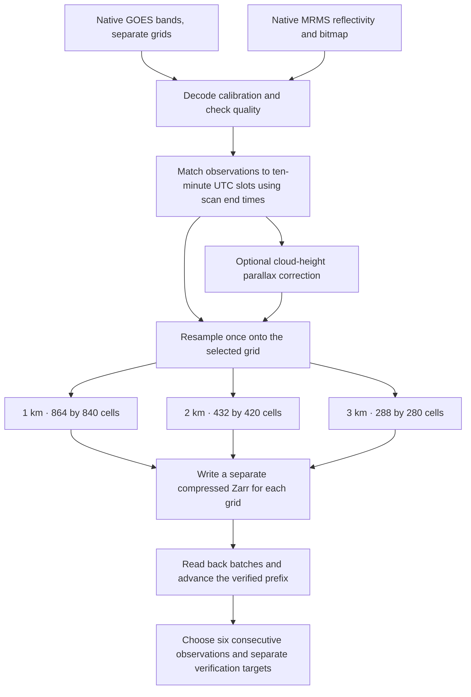
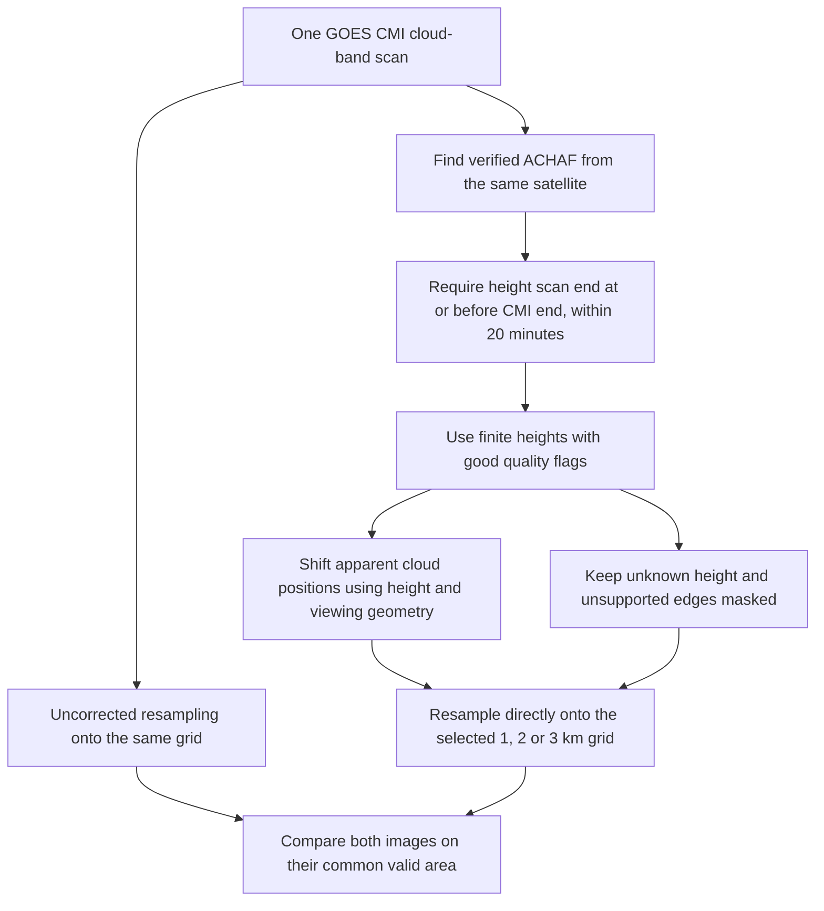

# Processing observations for regional model experiments

Use notebook [05 Process datasets](../notebooks/05_process_datasets.ipynb) or
`python scripts/dataset_jobs.py process`. Both call the same functions. Native
monthly NOAA archives remain unchanged; derived arrays contain explicitly decoded,
quality-screened and regridded observations.

## Storage and environments

| Data | Workstation | Polaris |
|---|---|---|
| Native observations | Existing monthly ZIPs on P: | Verified monthly ZIPs on Eagle |
| Reusable preparation | Dataset root/preparation | Dataset root/preparation on Eagle |
| Derived plain Zarr | Dataset root/processed | Allocation-local scratch/processed |
| Live index and compact results | Linux results/dataset-processing | Local SSD; closed summaries on Eagle |

New transformed stores use **plain Zarr v3**, with lossless Blosc/Zstd level 3.
They open directly with xarray and the stock PhysicsNeMo training reader.
Icechunk is no longer a derived-storage option. Superseded stores and their
unusable state are deleted after a verified replacement, rather than kept behind
an unsupported-reader message. See the [retirement policy](developer_guide.md#retiring-generated-data).
Optional native virtualization remains a separate, explicit experiment; ordinary
processing does not build a virtual catalog or require Icechunk.

Create `environment-processing.yml` for CPU work. GPU packages belong in
`environment-model.yml`; never upgrade acquisition to enable model experiments.

On Polaris, `jobs/polaris_process.pbs` also provides `ECORE_PROCESS_TASK=setup`,
`benchmark` and `setup-benchmark`. Setup runs on a compute node, builds a separate Conda environment from the Polaris Linux package lock through
the site proxy, then installs the processing dependencies. It checks imports and
a Zarr write and read-back. The previous offline clone failed when its package cache
was incomplete.

For a short 3 km timing comparison, source `jobs/polaris.env.sh` and submit:

```bash
qsub -A "$ECORE_PBS_ACCOUNT" -q debug -l walltime=01:00:00 \
  -v "$ECORE_PBS_ENV_VARS,ECORE_PROCESS_TASK=setup-benchmark,ECORE_PROCESS_START=2022-09-18T12:00:00Z,ECORE_PROCESS_END=2022-09-18T20:00:00Z,ECORE_PROCESS_RESOLUTION=3" \
  jobs/polaris_process.pbs
```

Combining setup and benchmarking avoids requiring two queued debug jobs. With
an already prepared environment, use `benchmark` alone.

The benchmark compares 8/16/32/64 independent processes and a two-thread
reference on the same eight-hour selection, with three rotated trials. These
are CPU-affinity-aware processes, not extra threads per core. It includes
native reads, transforms, writing, closing and final read-back; successful
temporary stores are removed. The compact `worker-benchmark.json` and selection
description stay in `ecore-weather/state/processing/` on Eagle. Change
`ECORE_PROCESS_STATE` to isolate simultaneous reports, and pass that variable
through `qsub -v`. Fetches should be stopped for this controlled comparison.
Use the measured result before selecting workers for a larger build; the
workstation's eight-process result does not establish the Polaris setting.
The latter uses Earth2Studio 0.20.0, PhysicsNeMo 2.2.2 and a matched Torch/NATTEN
wheel pair. Verify target-machine driver compatibility before installation.

## First commands

```bash
python scripts/dataset_jobs.py process index \
  --start 2022-09-18T14:00Z --end 2022-09-18T18:00Z --resolution-km 3
python scripts/dataset_jobs.py process estimate --selection PREPARATION_PATH
python scripts/dataset_jobs.py process materialize --selection PREPARATION_PATH
python scripts/dataset_jobs.py process validate --unit DERIVED_SELECTION/full
python scripts/dataset_jobs.py process status --unit DERIVED_SELECTION/full
```

Copy the preparation path printed by Index. Dates are UTC; end is excluded.
Use `--bands --radar refc refc_base` for radar-only work, or `--radar` for GOES-only
work. Missing files remain absent observations, never synthetic zeros.
A saved selection fixes its scientific recipe. Re-index to change its grid,
quality, correction or layout. `--config` sets defaults; explicit CLI arguments
win. Notebook controls do not fetch during construction.

## Measurements, grids and time

Restore GOES unsigned encoding, fill/range, scale/offset, DQF and calibration per
scan. C01/C02/C03 are reflectance factors; selected infrared bands are brightness
temperatures in kelvin. Strict-good accepts DQF 0; conditional additionally accepts
DQF 1. Unknown quality remains distinct. Do not infer an outage from visible-band
nighttime behavior.

Radar retains valid negative dBZ. Product sentinels -99/-999, bitmap gaps and
nonfinite values remain missing. There is no clear-air clamping. Normalization
belongs at the model boundary, not in reusable physical-unit arrays.

The full acquisition bbox is (-70.24, 14.36, -62.56, 22.04). The WGS84 LCC grid is
centered on 66.4 W, 18.2 N, with standard parallels 15/21 N. Bounds round outward
to 12 km, giving patch-compatible dimensions:

| Spacing | Rows × columns |
|---|---:|
| 1 km | 864 × 840 |
| 2 km | 432 × 420 |
| 3 km | 288 × 280 |

GOES uses bilinear interpolation with valid contributors; flags are categorical.
Radar uses nearest-neighbor sampling. Coordinates outside the bbox or source
support are masked. A 1 km output does not add detail to native 2 km infrared.

GOES scan ends must be at/before a slot and no more than ten minutes old; radar
keeps the five-minute rule. Observations are not reused. Actual start/end times
remain separate from nominal slots. Six states span 50 minutes. Training windows
add the next ten-minute target and must stay entirely within their split.
These rules describe observation-time causality, not historical delivery latency.

## Store contents and reading

Each full/block unit contains `data.zarr`, an atomic `progress.json`, and a
`complete.json` only after final verification. Preparation holds scientific
Parquet indices and recipes, not duplicate raw rasters.

| Array | Dimensions | Meaning |
|---|---|---|
| values | time, variable, y, x | Physical float32 observations; invalid pixels are NaN |
| pixel_valid | time, variable, y, x | Declared pixel-quality policy |
| quality, classes | time, variable, y, x | Source flags and missingness categories |
| source_support | time, variable, y, x | Interpolation has geographic support |
| valid | time | All required variables have an observation and usable pixels |
| source_time_ns, source_end_ns | time, variable | Actual source timestamps |
| latitude, longitude, inside_bbox | y, x | Geographic coordinates and region mask |
| height_known, parallax_applied | time, variable, y, x | Corrected variants only; usable height-supported geometry |

Timestamp validity does not mean every pixel is valid. A GOES-only recipe does
not require radar. Unknown-height pixels in corrected bands remain unsupported;
zeros in correction flags on unshifted bands do not classify their cloud state.

```python
import xarray as xr
from ecore_weather.processing.process_store import ProcessedSource

with xr.open_zarr('/path/full/data.zarr', consolidated=False,
                  mask_and_scale=False, chunks=None) as ds:
    image = ds['values'].sel(variable='abi13c').isel(time=6).load()

with ProcessedSource('/path/full') as source:
    window = source(['2022-09-18T15:00Z', '2022-09-18T15:10Z'], ['abi08c', 'abi13c'])
```

Requests preserve order, including shuffled windows. Each reader caches only
metadata/static coordinates; close it after use. Worker processes open their own
handles. The experimental Flash adapter remains an engineering check, not a
validated Caribbean forecast.

## Workstation processing parallelism

Materialization uses independent processes for native reads, calibration and
resampling. `--workers 0` uses all CPUs allowed by the job's CPU affinity (32
hardware threads on this workstation). `--workers N` sets an explicit count;
`--executor thread` is retained for comparisons. This is unrelated to the number
of CPUs in a Colab runtime.

Four batches are prepared ahead by default (`--prefetch-batches 4`), distributing
work across variables and time so more than ten processes can be occupied. Each
worker keeps its own small archive-handle and geometry caches. A single writer
commits batches in time order, checks their values, then advances the checkpoint.
Transform processes never share a writable store. While the writer commits one
batch, processes can prepare later batches. A pause preserves the committed
prefix and discards only uncommitted work.

`--memory-mib` bounds the planned output buffers plus an allowance for worker
interpreters, geometry and decoded native arrays. The full-study workstation
configuration supplies 65,536 MiB. The operating system and scientific index
also need RAM; memory is not a target to fill. Numerical libraries use one
thread per process to avoid multiplying hidden thread pools. Actual throughput
can stop improving before all CPUs are busy when ZIP reads or DAS writes dominate.

To compare process counts on a saved selection of at most two days:

```bash
python scripts/dataset_jobs.py process benchmark --selection SHORT_PREPARATION \
  --worker-counts 8 16 32 --repeats 1 \
  --destination /mnt/p/ecore_eo_datasets/processed
```

This compares against two threads and includes output verification and final
publication. It checks identical batch hashes, records CPU time and summed
process RSS, and removes successful temporary stores. It reads native archives
without downloading NOAA objects. Retain the compact worker-benchmark.json.

The workstation's current 3 km profile uses **eight processes**, four prefetched
batches and a 64 GiB memory allowance. An eight-hour, ten-variable selection
produced identical verified arrays in all twelve rotated trials:

| Transform workers | Median total runtime, three trials |
|---|---:|
| Two threads | 38.67 s |
| Eight processes | 26.71 s |
| Sixteen processes | 28.02 s |
| Thirty-two processes | 28.28 s |

Eight processes reduced runtime by 31% relative to the updated two-thread path.
More processes did not help this DAS sample. Peak summed RSS was approximately
6 GiB for the eight-process case; the memory allowance is a limit, not a request
to allocate 64 GiB. Source reads remained the largest accumulated transform cost.
These short tests include process startup and do not establish a full-study rate.
The older writer also did unnecessary directory walks and repeated array-metadata
opens; it now flushes exact chunk paths and reuses array handles. No verification
or durability check was removed.

## Checkpoints, capacity and layout

One coordinator assembles each all-channel batch, writes complete chunks/shards,
flushes and verifies it, then atomically advances the committed prefix. A restart
checks that prefix and overwrites the unfinished batch. No committed shard is
rewritten. Final publication closes/reopens the store and verifies it before the
completion marker. Reader leases prevent deletion while data are in use.

`--chunk-time 1|6|12`, `--shard-time 0|24` and `--spatial-chunk 0|256` describe
layout. Zero spatial size means a full-ROI frame. Twenty-four-frame shards keep
independently readable chunks and use complete 24-frame checkpoints. Ordinary
one-frame storage checkpoints eight slots. Do not select a layout from peak Mbps.

```bash
python scripts/dataset_jobs.py process benchmark --unit DERIVED_SELECTION/full \
  --destination /mnt/p/ecore_eo_datasets/processed --disk-mib 64 --repeats 3
```

Benchmarks include values, flags and timestamps through the actual model-facing
reader. They measure 1/6/12-frame reads, writes, verification, physical files and
bytes. Fetching must be paused. Application caches are fresh; OS caches are not
claimed cold. Temporary candidates are deleted after success.

On the workstation DAS, three repeated six-frame reads took a median 0.114 s
with one-frame, full-ROI chunks and 0.148 s with six-frame chunks. The former
is the selected layout. Twenty-four-frame shards reduced the number of files,
but were slower in screening. These are bounded model-window measurements,
not a claim about the DAS's maximum bandwidth or full-study training speed.

`auto` prefers a complete variant when measured output plus temporary requirements
fit; `full` requires it; `blocks` creates bounded temporal units. Retain 5% of total
filesystem capacity. Workstation outputs go directly to DAS. Polaris variants stay
on local SSD and must be consumed in the allocation; preparation persists on Eagle.
A full 3 km study has 289,008 nominal slots before history padding, about 932 GB
of float32 values and another 932 GB for four byte-sized pixel arrays before
compression. Use empirical compression and current free space, not NOAA file size.

The current full-study request is saved in `jobs/process_3km_study.json`. Its
sample-based retained-size estimate is approximately 496 GB, including a 20%
allowance. The live run record is
`results/dataset-processing/materialization-run.json`; use its `unit` with
`process status` to read the durable checkpoint. Index coverage and an estimate
do not establish that the full materialization has completed.

## From observations to model windows



The three grids use the same projected bounds. Grid spacing controls the training
and storage cost. A 1 km output grid retains finer source measurements where they
exist, such as GOES C02. Infrared observations still have their native information
content. GOES uses bilinear interpolation with valid contributors. MRMS uses the
nearest native value, and quality flags remain categorical.

## Cloud heights and parallax

The auxiliary native product is ABI-L2-ACHAF, not another forecast channel:

```bash
python scripts/dataset_jobs.py fetch goes --product ABI-L2-ACHAF \
  --start 2021-01-01 --end 2026-07-01 --destination /mnt/p/ecore_eo_datasets \
  --scratch /path/to/linux-scratch --output results/dataset-processing/heights --max-hours 0
```

This independently resumable job uses existing monthly storage/verification,
keeps native HT/DQF/status/calibration and includes a 50 km height-region margin.
Inspect actual historic grids; ACHAF is not assumed 2 km. Partial local batches
resume; completed monthly archives are durable. Unfinished node-local work may
be lost between Polaris allocations.

```bash
python scripts/dataset_jobs.py process index --start 2022-09-18T16:10Z \
  --end 2022-09-18T16:20Z --resolution-km 3 --correction cloud-height
python scripts/dataset_jobs.py process materialize --selection CORRECTED_PREPARATION
```

C01/C02/C03/C07/C13 use the newest same-platform height ending no later than CMI,
within twenty minutes. C08/C09/C10 stay unshifted. Unknown retrievals are not zero
height or inferred clear sky. Geometry and altitude units follow source metadata
and the documented Satpy approximation, not an exact ellipsoid claim. Corrected
CMI is resampled once onto the target grid. Mappings are reused only for identical
height evidence/native geometry/target grids; caches are bounded.

[Satpy's parallax API](https://satpy.readthedocs.io/en/stable/api/satpy.modifiers.parallax.html)
can replace undefined heights internally, so an independent uncertainty mask is
required. It does not guarantee that existing native ROI margins support every
corrected boundary pixel. Parallax figures belong under
`figures/dataset-processing/parallax/`, and bounded model comparison figures
belong under `figures/dataset-processing/model-checks/`.

### Compare the effect of cloud height



Tall clouds can appear displaced from where they sit over the surface. That
matters when comparing cloud structure with radar or associating features across
channels. Notebook 05's **Compare parallax** button holds the source scan, band,
grid, and common valid area fixed. Change the UTC slot and grid independently
to see how interior shifts and edge losses behave. C08/C09/C10 stay unshifted
under the current recipe.

To start the storm windows first, add `--storm-heights-first --workers 4` to the
ACHAF acquisition command above. The job includes earlier heights for the demo's
input histories and then continues through the requested study period. The
small `process parallax` investigation has its own 4 GiB transfer limit.
The 17 verified pilot scans occupied 649,121 bytes across three ZIPs. Scaling
that sample to an uninterrupted ten-minute study suggests about 11 GB of retained
height data. Grid changes, quality and compression can change that estimate,
and source transfer and temporary packing space are separate.

On the workstation, resume the interrupted DAS build with the existing study
configuration and its saved preparation selection after a successful disk
write/read probe. The writer verifies every committed batch before advancing.
That scan can take substantial time on the DAS while the displayed committed
count stays fixed. The background height launcher starts only once the first new
3 km checkpoint is written.

## Statistics, stock loading and inference

```bash
python scripts/dataset_jobs.py process stats --unit DERIVED_SELECTION/full \
  --train-start 2021-01-01 --train-end 2025-01-01
python scripts/dataset_jobs.py process loader-check --unit DERIVED_SELECTION/full \
  --physicsnemo-reference /path/to/regional_weather_diffusion/datasets
```

Training-only population moments go in stats.json; geographic fields go in
invariants.zarr. Empty/constant channels are errors. Validation is calendar 2025;
January–June 2026 is held out. Histories/targets may not cross split boundaries.
The [stock XarrayDataset contract](https://docs.nvidia.com/physicsnemo/latest/physicsnemo/examples/weather/regional_weather_diffusion/docs/XARRAY_DATASET.html)
uses these files directly. This check does not start training.

Pretrained inference uses checkpoint normalizers, not these regional statistics.
The separate model environment needs matching Torch/CUDA/NATTEN wheels, Flash
APIs, model weights and documented regional static fields. See
[model requirements](StormScope-paper-notes.md). Colab uses a bounded copied example;
Polaris uses a short allocation. Neither requires transferring the full study.
A supported-CONUS reference and a Caribbean engineering test are different checks.
Missing GPU/access/dependencies must produce an explicit blocked result.

The supported-CONUS reference completed two Flash steps on Colab L4 with the
CUDA 13 model environment. This closes the model execution smoke test; it does
not establish that the prepared Caribbean arrays satisfy every released model
requirement. No private dataset was uploaded for the CONUS check. A separately
approved Caribbean run used a bounded input and explicitly approximate elevation
scaling; its result is described below.

### A bounded Caribbean input while the full store is still being written

Use only the verified prefix, rather than waiting for the full study or reading
unwritten time slots. This command exports six ten-minute frames with their
coordinates, actual source times, quality masks and a scientific checksum:

```bash
python scripts/dataset_jobs.py process model-sample --unit FULL_STUDY_UNIT \
  --sample-time 2021-01-15T16:00Z --crop-size 256 --allow-partial \
  --output .cache/caribbean-flash-input
```

The January example has joint valid coverage of 99.98% across all eight bands
in its 256 × 256 crop. The export fixes the committed prefix at the moment it
opens the store; ongoing processing can continue. It rejects absent/future
observations and leaves every source array unchanged. Keep this small transfer
payload outside results/; retain its compact manifest with the model result.

Run the shared inference interface in the isolated GPU environment:

```bash
python scripts/dataset_jobs.py process model-check \
  --sample .cache/caribbean-flash-input/caribbean-sample.npz \
  --elevation .cache/caribbean-flash-input/caribbean-elevation.tif \
  --experimental-caribbean --download-model
```

The elevation sidecar must explain units, scaling, ocean treatment and evidence.
An empirical approximation is rejected by default. It requires the separate
`--allow-approximate-topography` option and produces explicitly experimental
results. This does not establish the released checkpoint's geographic validity.
Bounded forecast arrays are written beside model-check.json for inspection;
they are separate from the materialized observations.

After the approved approximate-topography run, both forecasts completed with
finite supported pixels. Compare the returned NPZ with later local observations:

```bash
python scripts/dataset_jobs.py process model-compare \
  --sample .cache/caribbean-flash-input/caribbean-sample.npz \
  --forecast .cache/caribbean-flash-input/caribbean-forecast.npz
```

This checks band order, grid coordinates and the last input, then reads only
committed observations for the forecast times. It writes per-band MAE/RMSE and
persistence errors to compact CSV/JSON and one figure under figures/. Later
observations never enter the inference payload. Persistence means repeating the
last input image. One January example beat that baseline across all eight bands
at both leads; it does not establish regional forecasting skill. See the model
notes for timings, static-field uncertainty and the example comparison.

## NAM/RRFS audit and storm demo

The [metadata-only NAM audit](nam_audit.md) covers the full study period
and includes a field catalog and storage estimates. It reads object listings
and text indexes without downloading GRIB forecasts.

The earlier sample audit also decodes selected messages. From the checkout
with the processing environment active:

```bash
python scripts/dataset_jobs.py process nam-audit --output results/dataset-processing
```

The 4 GiB audit checks each storm hour and samples three NAM cycles per study
month. It reads only selected GRIB ranges and inspects one operational RRFS
Puerto Rico case separately. Open the generated `nam-rrfs-audit.md` for readable
coverage and size tables. The companion JSON preserves the selected run, lead,
S3 availability timestamp and fallback evidence for each hour. Source reports
are bounded samples outside the seven storm windows. An S3 archive timestamp
cannot establish availability when the file was added or replaced after the
forecast cutoff. Keep such hours visible as gaps.

The November 19 audit found eligible NAM reflectivity in all 180 requested hours
across Earl, Fiona, Philippe, Ernesto, and Erin. No eligible Puerto Rico nest
files were found for Fred or Grace's combined 52 hours. It sampled 198 monthly
cycles and decoded 133 NAM messages, plus one operational RRFS temperature
message. The measured NAM footprint covers about 91.0% of the acquisition box
on the 3 km grid and 95.9% of the centered model crop.

### Select NAM forecasts by tropical cyclone

Use the [North Atlantic IBTrACS v04r01 CSV](https://www.ncei.noaa.gov/products/international-best-track-archive)
to find main tracks crossing the acquisition box. The selector records the
snapshot checksum, uses UTC and USA position fields, and checks segments between
fixes up to six hours apart. A crossing window starts 12 hours before entry
and ends 24 hours after exit, rounded outward to hourly boundaries and clipped
to the study period. Overlapping windows for a storm merge. An offshore track
can still produce rain over Puerto Rico. The review table lists nearby misses
separately, and local Pass2 rain summaries are available with `--event-rain`.

```bash
python scripts/dataset_jobs.py process nam-events \
  --output results/dataset-processing/nam-events \
  --figure-dir figures/dataset-processing/nam-events
```

Planning reads the track CSV, NOAA listings and GRIB text indexes. It saves
`events.csv`, `cycles.csv`, the map and `selection.json.gz`. Use
`--event-storm Fiona --event-max-hours 3` and a separate output directory to
repeat the small Fiona pilot. Use `--ibtracs` to reproduce a plan from a local
snapshot or `--event-limit` to limit the number of closest tracks.

For each initialization hour H, the plan retains every eligible NAM Puerto Rico
nest cycle supplying a field valid at H or H+1, using the archive timestamp by H.
The timestamp is evidence of archive availability. The paired-cycle table lists
the newest same-cycle pair first for each field. Exact-hour selection preserves
lead time, levels, units and accumulation intervals. A missing comparison hour
or field remains a gap. This collection includes the ten core fields from the
[NAM field catalog](nam_audit.md).

```bash
python scripts/dataset_jobs.py process nam-events --apply \
  --event-plan results/dataset-processing/nam-events/selection.json.gz \
  --location /mnt/p/ecore_eo_datasets --output results/dataset-processing/nam-events
```

Apply reads each selected GRIB message once and reuses shared ranges. Verified
monthly stores live under `nwp/nam/priconest/<selection>/<YYYY-MM>/data.zarr`
in the specified location. Open only months with a `complete.json` marker.
The selection records source identities; the monthly progress record contains
the field units, accumulation intervals and read-back checksums. The apply
command reopens and checks saved rows before continuing. It uses a cumulative
transfer ceiling of 125% of the listed GRIB ranges unless you supply
`--max-transfer-gib`. The Fiona pilot used 52.1 MB of GRIB ranges and retained
51.5 MB for 38 forecasts.

The November 17 IBTrACS snapshot yielded 16 storms and 17 encounters, with
eligible data for 843 of 1,107 requested storm hours. Elsa, Fred, Grace and
Peter account for the gaps in early 2021. The full selection listed 8,404
forecast objects and 11.71 GB of selected ranges, alongside 33.45 GB of
uncompressed cropped fields. These are planning estimates until apply verifies
the arrays.

Notebook 07 loads one NAM and GOES pair on demand. Notebook 08 reads the
selected time range from a shared Zarr v3 storm store. Choose an initialization
hour H and a correction variant. Flash uses six observations from H−50 through H
and advances its own predictions through H+60 in ten-minute steps. The six maps
compare predictions with later GOES observations. NAM shows valid hour H in the
first five rows and H+1 in the last. For each selected variable, both NAM fields
come from an eligible cycle available in the archive by H. The display includes
the cycle, valid hour, forecast lead and any accumulation interval.

Band and NAM menus redraw the most recent cached prediction. Changing the
correction choice changes the model input. Correction applies to C01, C02, C03,
C07 and C13 where heights provide valid support.

A Fiona test loaded the 12 frames needed for one comparison from a cold local
Hugging Face cache. The previous NPZ took 2.61 seconds and fetched 27.4 MB.
Concurrent reads of unsharded six-frame Zarr chunks took 3.62 seconds and
fetched 18.2 MB. Both layouts loaded from a warm cache in about a third of a
second. These are medians from three runs per layout on one storm window.
The Zarr default uses six-frame chunks without sharding. Twelve-frame shards
took 3.83 seconds with concurrent reads in the same test.

On Colab L4 one Fiona uncorrected run took 62 seconds including the initial
model load. The corrected run took 8.8 seconds with the model already loaded.
Changing the displayed GOES band and NAM field made no new inference calls.
The default dataset revision contains both variants for all seven storms. To try
the one-hour pilot, set `os.environ['ECORE_STORM_DEMO_REVISION'] = 'zarr-v2-pilot'`
in a cell before running the notebook. The default revision is the full dataset
after publication.

Notebook 05 separates job status, selection, build review, previews and
validation. Use **Review build** to see the estimated storage and the path of
any old store that would be deleted. **Build processed dataset** starts the
background job. Identical selections resume from verified slots. A different
selection requires explicit confirmation and an idle store with no readers.
For the equivalent CLI workflow, pass `--managed-store` to `process materialize`
and use `--replace-store /exact/path/to/old/selection` after reviewing the
existing data. The notebook manages the primary full dataset. Existing
research outputs and the bounded demo export have separate lifecycles.

The demo data are published at the end of this guide. Colab uses a separate
Python 3.12 environment for the CUDA 13 model wheels while the widget kernel may
run a newer Python. For a Colab test of local, unpublished source, create a
source-only bundle and place it at `/content/ecore-demo-source.zip` before setup.
The first setup builds Earth2Grid against the runtime's CUDA compiler and can
take several minutes. The model environment includes SciPy and uses a headless
plotting backend. The notebook kernel displays the comparison figure.

```bash
python - <<'PY'
from pathlib import Path
from zipfile import ZIP_DEFLATED, ZipFile
with ZipFile('ecore-demo-source.zip', 'w', ZIP_DEFLATED) as bundle:
    for path in Path('src/ecore_weather').rglob('*.py'):
        bundle.write(path, path.as_posix())
PY
```

[Public seven-storm dataset](https://huggingface.co/datasets/asvnpr/ecore-stormscope-demo)

The public export is produced from verified 3 km stores:

```bash
python scripts/dataset_jobs.py process demo-export --demo-unit /path/to/full \
  --elevation /path/to/caribbean-elevation.tif --demo-root /path/to/demo \
  --output results/dataset-processing
```

Repeat `--demo-unit` for verified bounded stores covering an unfinished part of
the study. Use a fresh `--demo-root` and pass `--location` for the verified native
GOES and ACHAF archives. Supply `--demo-hour` to export a bounded pilot. The export keeps the documented approximate elevation calibration and
the original native archives. The Colab execution checks an experimental
Caribbean adaptation of the CONUS checkpoint against GOES observations.
An L4 check produced all three ten-minute forecasts for one hour each of Fiona,
Fred and Erin. Matching NAM fields were available for Fiona and Erin. Preparing
the three forecast rows took about seven seconds per hour after the data and
model had loaded.

Keep one processing database and current compact operation summaries. Preserve
source provenance with the native archives.
